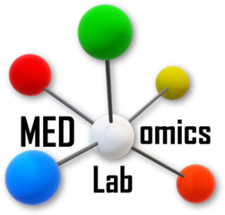

  

     
    <picture>
      <source media="(prefers-color-scheme: dark)" srcset="assets/medomicslab-logo-white.png">
      
    </picture>
  

  <h1>MEDomicsLab Discussions</h1>
  <h4>Questions, feedback, and proof-of-concept studies for the lab's projects.</h4>
  
<a href="https://github.com/orgs/MEDomicsLab/discussions">Open Discussions</a>

## Publish an announcement

1. Open [the organization's Discussions](https://github.com/orgs/MEDomicsLab/discussions), click **New discussion**, and select **Announcements**.
2. Write your announcement in the **Discussion title** and **Write** fields, then click **Start discussion**.
3. To feature the post, use **Pin discussion** in the right sidebar.

Published posts live in the organization’s **Discussions** tab as numbered threads, separate from the files tracked by Git.

Use **New discussion** for **Questions**, **Feedback**, or the project’s review category under **Proof of Concept**.

For a study briefing or category guide, publish it in **Announcements** first, then move it to the target category and pin it there. This keeps the initial post from triggering routing notifications.

## Maintainer settings

Edit [`discussions.json`](discussions.json) to update project labels and who gets mentioned.

- `scopes` maps each Questions and Feedback scope to its label and maintainers. To add a scope, create its label and update both form dropdowns.
- `proof_of_concept` maps each review category to its project name and maintainers. To add a project, create its category and matching form at `.github/DISCUSSION_TEMPLATE/<category-slug>.yml`.
- `excluded_discussions` lists guides and briefings that should skip routing.

List usernames in the order they should be mentioned.
